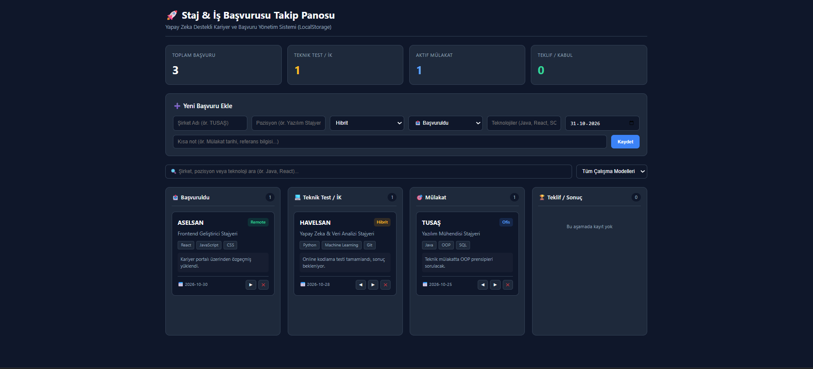

## Staj & İş Başvurusu Takip Panosu 

Bu proje, öğrencilerin ve staj arayan kişilerin mülakatlarını listeleyebileceği, hangi aşamada olduğunu kontroledebileceği bir tablo tabanlı kontrol sistemi yaptım.

##  Proje Ekran Görüntüsü



##  Proje Açıklaması ve Özellikler

Uygulama, iş ve staj başvuru süreçlerini **Başvuruldu**, **Teknik Test / İK**, **Mülakat** ve **Teklif / Sonuç** olmak üzere 4 aşamalı bir tablo panosu üzerinde yönetmeyi sağlar:
- **Özet İstatistik Kartları:** Toplam başvuru, teknik test, aktif mülakat ve teklif sayılarını anlık olarak hesaplar.
- **Dinamik Başvuru Ekleme:** Şirket adı, pozisyon, çalışma modeli (Ofis, Hibrit, Remote gibi 3 grupa ayrılmış), kullanılan teknolojiler, başvuru tarihi ve özel notlar eklenebilir.
- **Arama ve Filtreleme:** Şirket adı, pozisyon veya teknoloji etiketine (ör. Java, React, Python) göre anlık arama ve çalışma modeline göre filtreleme yapılabilir.
- **Durum Yönetimi ve Kalıcı Veri:** Kartlar aşamalar arasında ileri/geri taşınabilir, silinebilir ve tüm veriler tarayıcının `localStorage` alanında otomatik olarak saklanır.

##  Kullanılan Teknolojiler

- **Frontend Çatısı:** React 18 (Vite ile oluşturulmuştur)
- **Stil & Tasarım:** Saf CSS (Pure CSS - CSS Değişkenleri, Flexbox ve CSS Grid mimarisi)
- **Veri Saklama:** Tarayıcı Yerel Depolama (`window.localStorage`)
- **Geliştirme Ortamı (IDE):** Visual Studio Code
- **Yapay Zeka Asistanı:** Google Gemini

##  Yapay Zeka Geliştirme Sürecinde Nasıl Kullanıldı?

Projenin canlıya alınması bazı bilgi boşluklarının doldurulması ve güzel bir şekilde tanıtılması için  **Google Gemini** yardımcı olarak kullanıldı.

1. **Planlama ve Veri Modeli Tasarımı:** Uygulamanın ekran bileşenleri, kullanıcı deneyimi akışı ve `localStorage` üzerinde tutulacak JSON veri şeması yapay zeka ile birlikte kurgulandı.
2. **Bileşen Üretimi ve Stil Önerisi:** React `useState` ve `useEffect` kancalarıyla (hooks) veri kalıcılığını sağlayan bileşen kodları ve koyu tema (Dark Mode) modern CSS tasarım değişkenleri üretildi.
3. **Kurulum ve Hata Ayıklama (Debugging):** Vs Code üzerinde çalışmaya başlandığında Node.js kurulumu çalıştırılması ve planlanan kod satırlarının gereksiz satırlardan arındırılması ve düzenlenmesi alanında yapay zekadan destek alındı.
4. **Dokümantasyon:** Projenin açıklanması ve ReadMe dosyasının oluşturulmasında daha net ve açıklayıcı(linkle yol gösterme doğru sıra ile sunma) ifadeler kullanabilmek için yapay zekadan destek alındı.

##  Kurulum ve Çalıştırma Adımları

Projeyi çalıştırmak için

1. Depoyu bilgisayarınıza kopyalayın:
   ```bash
   git clone [https://github.com/Suleyman-k/Staj_Takip_Panosu.git](https://github.com/Suleyman-k/Staj_Takip_Panosu.git)